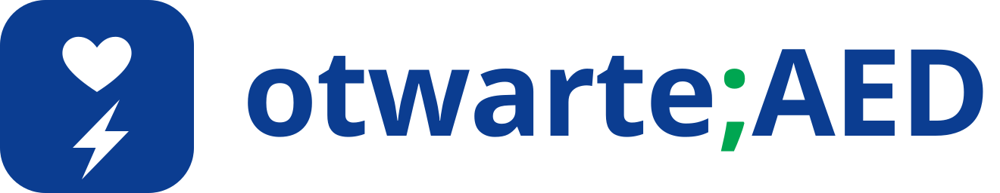
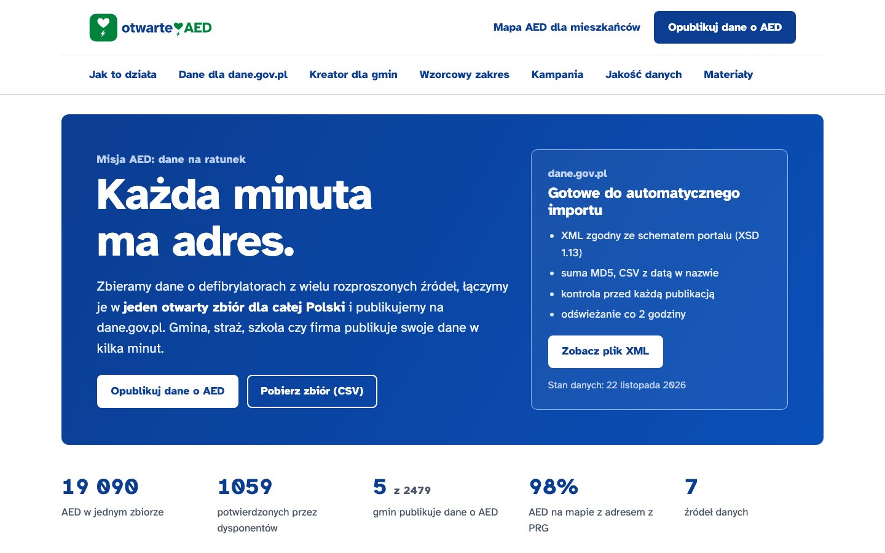

<a id="readme-top"></a>

<div align="center">
  <a href="https://otwarteaed.pl">
    
  </a>

  <h3 align="center">Każda minuta ma adres.</h3>

  <p align="center">
    Hub danych o defibrylatorach AED dla portalu dane.gov.pl: jeden otwarty zbiór dla całej Polski, kreator dla gmin i kampania dla dysponentów.
    <br>
    <b>Misja AED — Dane na ratunek · HackNation 2026 · Ministerstwo Cyfryzacji</b>
    <br><br>
    <a href="https://otwarteaed.pl"><strong>otwarteaed.pl »</strong></a>
    &nbsp;·&nbsp;
    <a href="https://gdzieaed.pl">Mapa gdzieaed.pl</a>
    &nbsp;·&nbsp;
    <a href="https://youtu.be/6z07MNqQFEI">Film (2 min)</a>
    &nbsp;·&nbsp;
    <a href="docs/prezentacja.pdf">Prezentacja (PDF)</a>
    &nbsp;·&nbsp;
    <a href="https://otwarteaed.pl/materialy/">Materiały</a>
  </p>

  <p align="center">
    
    
    
    
    
    
  </p>
</div>

<details>
  <summary>Spis treści</summary>
  <ol>
    <li><a href="#o-projekcie">O projekcie</a></li>
    <li><a href="#wymagania-zadania-i-gdzie-są-spełnione">Wymagania zadania i gdzie są spełnione</a></li>
    <li><a href="#jak-sprawdzić-w-2-minuty">Jak sprawdzić w 2 minuty</a></li>
    <li><a href="#zbudowane-z">Zbudowane z</a></li>
    <li><a href="#uruchomienie-lokalne">Uruchomienie lokalne</a></li>
    <li><a href="#struktura">Struktura</a></li>
    <li><a href="#co-dalej">Co dalej</a></li>
    <li><a href="#licencje">Licencje</a></li>
    <li><a href="#podziękowania">Podziękowania</a></li>
  </ol>
</details>

## O projekcie

<a href="https://otwarteaed.pl"></a>

Dane o defibrylatorach AED w Polsce są rozproszone: ok. 18 tys. punktów w OpenStreetMap, prawie wszystkie bez adresu, i kilka zbiorów gmin i miast na dane.gov.pl, każdy w innym formacie. **otwarte AED** łączy je w jeden zbiór:

* **Harvester** pobiera dane z 7 źródeł co 2 godziny, rozpoznaje układ każdego pliku, naprawia współrzędne (przecinek, PL-1992, zamienione osie), dodaje adres i TERYT z rejestru PRG i scala duplikaty bez utraty danych. Każdy rekord ma listę źródeł i ocenę jakości.
* **Zbiór dla dane.gov.pl:** CSV UTF-8 (RFC 4180), XLSX i GeoJSON oraz plik XML z MD5 do automatycznego importu, zgodny z oficjalnym schematem portalu. Przed każdą publikacją hub sam sprawdza wynik.
* **Wzorcowy zakres danych:** 39 pól, słowniki wartości i dwa proste szablony dla gmin („mam współrzędne” i „mam tylko adresy”).
* **Kreator dla gmin i dysponentów:** wgrywasz swój plik i dostajesz gotowe CSV, XML i MD5 do publikacji. Plik nie opuszcza komputera.
* **Kampania „otwarte AED”** dla dysponentów: logo i księga znaku, odznaka do BIP, posty, list do gmin, plan na 12 miesięcy i lista „białych plam”, czyli gmin bez żadnego AED w zbiorze.
* **gdzieaed.pl:** te same dane dla mieszkańców: mapa najbliższych AED i karta „Najbliższy AED” do wydruku dla dowolnego adresu.

W nagłym wypadku dzwoń 112. To nie jest urzędowa ewidencja AED.

<p align="right">(<a href="#readme-top">do góry</a>)</p>

## Wymagania zadania i gdzie są spełnione

| Wymaganie (treść zadania) | Gdzie |
|---|---|
| Szczegółowy opis i tytuł projektu | [docs/opis_projektu.md](docs/opis_projektu.md) |
| Prezentacja: zrzuty ekranu jako dowody wymagań technicznych, kroki użytkownika, ograniczenia | [docs/prezentacja.pdf](docs/prezentacja.pdf): wymagania na slajdzie 2, dowody na slajdach 5–11, kroki użytkownika na 16, ograniczenia na 18 |
| Prototyp rozwiązania | https://otwarteaed.pl, https://gdzieaed.pl; kod w tym repozytorium |
| Wzorcowy zakres danych (XLSX) | [otwarteaed/dane/wzorcowy_zakres_danych.xlsx](otwarteaed/dane/wzorcowy_zakres_danych.xlsx); szablony w [otwarteaed/dane/szablony/](otwarteaed/dane/szablony/) |
| Kod źródłowy | to repozytorium (`hub/`, `otwarteaed/`, `public/`, `test/`) |
| Logotyp JPG, PNG, PDF i format otwarty (SVG) | [kampania/logo/](kampania/logo/) |
| Księga znaku (PDF) | [kampania/ksiega_znaku.pdf](kampania/ksiega_znaku.pdf) |
| Dane w formatach odczytywalnych maszynowo | CSV UTF-8, XLSX, GeoJSON, XML, JSON w [otwarteaed/dane/](otwarteaed/dane/) |
| Zgodność z zasadami działania dane.gov.pl | [otwarteaed/dane/dane_gov_pl.xml](otwarteaed/dane/dane_gov_pl.xml) i plik `.md5`; XML jest walidowany oficjalnym XSD 1.13 w testach |
| WCAG, responsywność, UX | Lighthouse (dostępność) 100/100 na obu stronach; zrzuty 390 px na slajdzie 11 |
| Zakres wykorzystania AI (regulamin zadania, §2 pkt 8) | [docs/oswiadczenie_ai.md](docs/oswiadczenie_ai.md), slajd 19 |
| Nazwa akcji, hasło, logotyp; zachęta dla dysponentów | „otwarte AED”, „Każda minuta ma adres.”; [kampania/dla_dysponentow/](kampania/dla_dysponentow/): odznaka, posty, list, plan kampanii z miernikami; [kampania/naklejki.pdf](kampania/naklejki.pdf) |
| Ograniczenia | [docs/ograniczenia.md](docs/ograniczenia.md) |

<p align="right">(<a href="#readme-top">do góry</a>)</p>

## Jak sprawdzić w 2 minuty

Film demonstracyjny (2 min): https://youtu.be/6z07MNqQFEI

1. Otwórz https://otwarteaed.pl i kliknij **„Wypróbuj na prawdziwym pliku Marek z dane.gov.pl”**. Kreator rozpozna plik gminy, naprawi zamienione osie, doda adresy i TERYT z PRG i przygotuje CSV, XML i MD5.
2. Pobierz plik dla dane.gov.pl i sprawdź go oficjalnym schematem portalu:
   ```sh
   curl -sO https://otwarteaed.pl/dane/dane_gov_pl.xml
   curl -sO https://dane.gov.pl/static/xml/otwarte_dane_latest.xsd
   xmllint --noout --schema otwarte_dane_latest.xsd dane_gov_pl.xml
   ```
3. Otwórz https://otwarteaed.pl/dane/wzorcowy_zakres_danych.xlsx w Excelu.

<p align="right">(<a href="#readme-top">do góry</a>)</p>

## Zbudowane z

* **Node.js 22** (moduły ES, bez zależności npm; ten sam kod działa w harvesterze i w przeglądarce)
* **Leaflet** i mapy **OpenStreetMap** (gdzieaed.pl)
* **PRG — punkty adresowe GUGiK** (usługa UUG) i granice gmin (WFS)
* **Schemat XML dane.gov.pl** (XSD 1.13) i `xmllint`
* **GitHub Actions** (aktualizacja co 2 godziny z walidacją) i **Cloudflare Pages**
* Krój **Atkinson Hyperlegible**

<p align="right">(<a href="#readme-top">do góry</a>)</p>

## Uruchomienie lokalne

Wymagania: Node.js 22 lub nowszy, `xmllint` (dla testu XSD). Bez instalowania pakietów npm.

```sh
npm test                                         # 82 testy, także na prawdziwych plikach z dane.gov.pl
node hub/zbierz.mjs --offline --bez-zapytan      # przebieg na zamrożonych danych z wejscie/ → otwarteaed/dane/
node hub/zbierz.mjs                              # najnowsze zasoby z dane.gov.pl i nowe adresy z PRG
npm run strony                                   # buduje dist/otwarteaed i dist/gdzieaed
python3 -m http.server 8000 -d dist/otwarteaed   # http://localhost:8000
```

Jak dodać nowe źródło danych (także plik z datą w nazwie): [docs/jak_dodac_zrodlo.md](docs/jak_dodac_zrodlo.md). API i formaty plików: [docs/api.md](docs/api.md).

<p align="right">(<a href="#readme-top">do góry</a>)</p>

## Struktura

| Katalog | Zawartość |
|---|---|
| `hub/` | rdzeń harvestera (moduły ES, działają w Node i w przeglądarce): odczyt plików, rozpoznawanie układu, normalizacja, adresy PRG, scalanie, jakość, eksport, własny zapis XLSX i MD5 |
| `zrodla/`, `szablony/` | profile źródeł danych i dwa szablony dla gmin |
| `wejscie/`, `baza/` | zamrożone pliki wejściowe i baza adresów PRG |
| `otwarteaed/` | strona otwarteaed.pl: dane, kreator, kampania; `otwarteaed/dane/` to wynik harvestera |
| `public/` | strona gdzieaed.pl (mapa) |
| `kampania/` | logo, księga znaku, naklejki, materiały dla dysponentów |
| `docs/` | opis, prezentacja, ograniczenia, oświadczenie o AI, propozycja PSP/OSP |

<p align="right">(<a href="#readme-top">do góry</a>)</p>

## Co dalej

- [x] Jeden zbiór z 7 źródeł, XML dla dane.gov.pl, kreator dla gmin, wzorcowy zakres danych
- [x] Kampania: logo, księga znaku, materiały dla dysponentów, białe plamy
- [ ] Automatyczny import na dane.gov.pl po stronie Ministerstwa
- [ ] Pierwsze gminy z listy białych plam i dane od PSP i OSP ([propozycja](docs/propozycja_psp_osp.md))
- [ ] Kolejne źródła miejskie i pola o przeglądach urządzeń (`termin_elektrod`, `termin_baterii`)

Plan kampanii na 12 miesięcy z miernikami: [kampania/dla_dysponentow/plan_kampanii.pdf](kampania/dla_dysponentow/plan_kampanii.pdf). Ograniczenia: [docs/ograniczenia.md](docs/ograniczenia.md).

<p align="right">(<a href="#readme-top">do góry</a>)</p>

## Licencje

**Dane.** Zbiór zintegrowany zawiera dane © współtwórców OpenStreetMap (ODbL 1.0) oraz dane dysponentów: Krosno, Przemyśl, Legionowo (CC0 1.0), Marki, ZTM w Gdańsku (CC BY 4.0), m.st. Warszawa — Stołeczne Centrum Bezpieczeństwa (CC BY). Licencja jest zapisana przy każdym rekordzie. Adresy: PRG, GUGiK.

**Kod, logo i materiały kampanii** są autorskim rozwiązaniem zespołu przygotowanym na HackNation 2026. Zgodnie z regulaminem zadania (§4) autorskie prawa majątkowe do zwycięskiego rozwiązania przechodzą na Ministra Cyfryzacji.

**Zasoby zewnętrzne:** Leaflet (BSD-2-Clause), krój Atkinson Hyperlegible (SIL OFL 1.1), podkład muzyczny filmu z ElevenLabs (licencja komercyjna). Zakres użycia AI: [docs/oswiadczenie_ai.md](docs/oswiadczenie_ai.md).

<p align="right">(<a href="#readme-top">do góry</a>)</p>

## Podziękowania

* Mentorom Departamentu Zarządzania Danymi Ministerstwa Cyfryzacji za uwagi, które zmieniły zakres projektu
* Współtwórcom OpenStreetMap, gminom i instytucjom, które już publikują dane o AED
* GUGiK za otwarte usługi PRG i zespołowi portalu dane.gov.pl za dokumentację importu
* [Best-README-Template](https://github.com/othneildrew/Best-README-Template) za układ tego pliku

<p align="right">(<a href="#readme-top">do góry</a>)</p>
